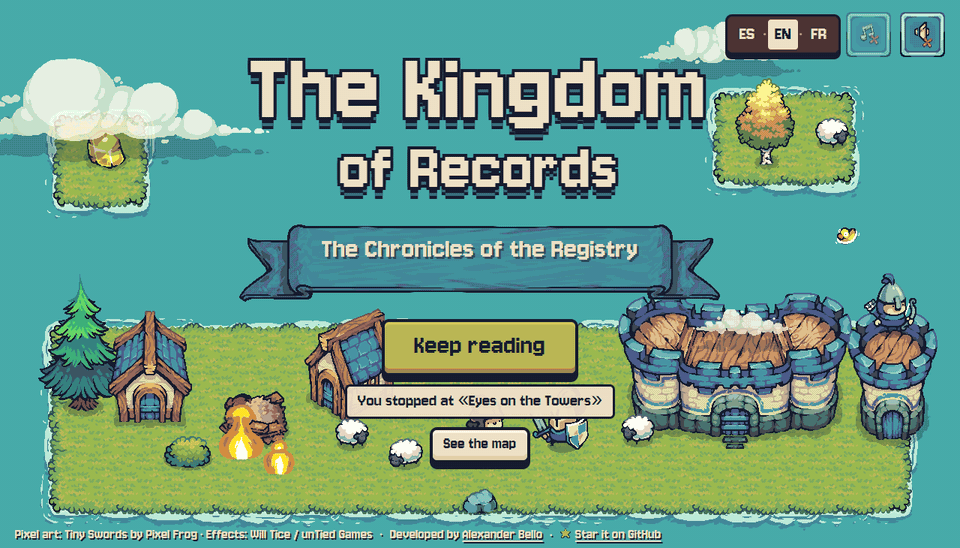
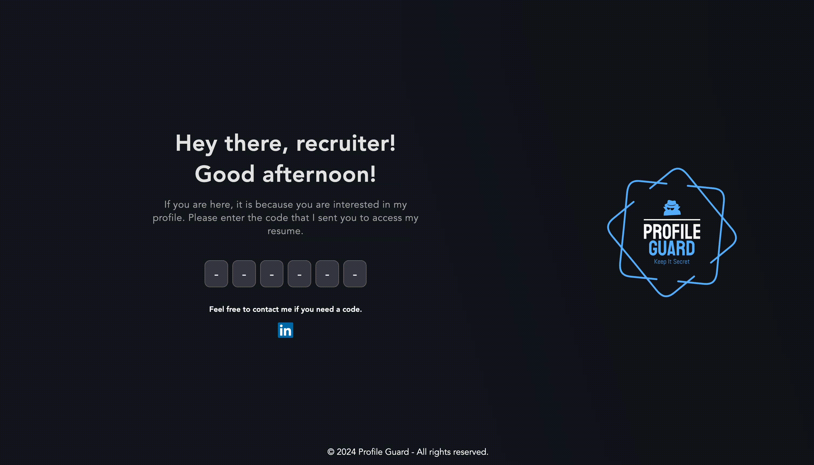
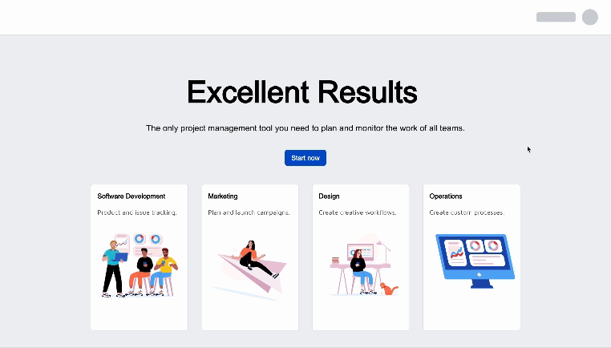
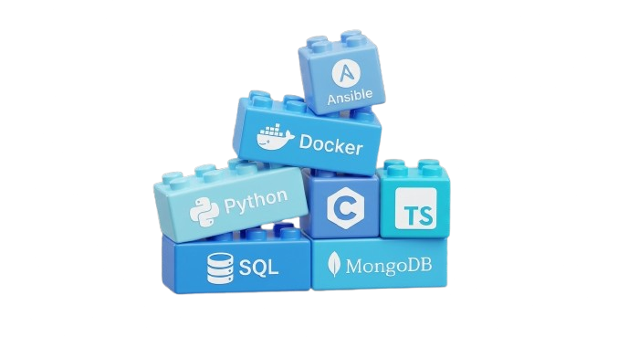

 
   

 

## <picture></picture> **About me** 

Software developer with 5 years of professional experience building products that solve real problems. I love hackathons, experimenting with AI, and creating things from scratch whether it's code or LEGO. Trained at 42 Madrid, where I learned to break down complex challenges into manageable pieces.

## <picture></picture> **Main projects** 

<table>
<tr>
<td>
<h3 align="center">The Kingdom of Records</h3>

 

A pixel-art game to learn SQL by solving a medieval mystery: 15 levels in English, Spanish and French, with real SQL running in the browser.

</td>
</tr>
</table>
<table>
<tr>
<td width="50%">
<h3 align="center">Profile Guard [Portfolio]</h3>

 

The portfolio ensures robust protection of confidential data through cryptographic methods, guaranteeing secure access and management of sensitive content.

</td>
<td width="50%">
<h3 align="center">NotJira</h3>

 

 

The Jira clone includes project management essentials with data tables, charts, translations, user authentication, and API security, built for educational purposes.

</td>
</tr>
</table>

###

## <picture></picture> **Tech Stack & Achievements**

<table>
<tr>
<td width="50%">

 

I've worked with a lot of different technologies throughout my career, but here's my core stack the foundation I keep coming back to. Could I show this with standard tech icons? Sure. But where's the fun in that when you have LEGO?

                                                                                      
</td>

<td width="50%">

**🥇 First Place - CyberLegal Málaga Hackathon** • *Feb 2023*  

Developed an AI-powered chatbot automating lawyer-client interactions and scheduling. Built with GDPR compliance and WCAG accessibility standards during a 48-hour sprint at Málaga's Law Society.

---

**🥇 First Place - HackForGood Málaga** • *Oct 2022*  

Created a web platform helping households reduce energy consumption through personalized recommendations based on usage patterns, contracts, and household parameters. Organized by UMA.

